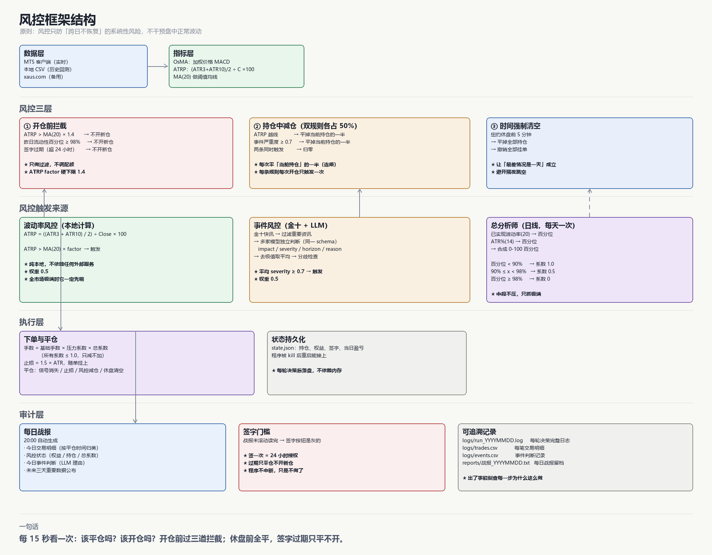
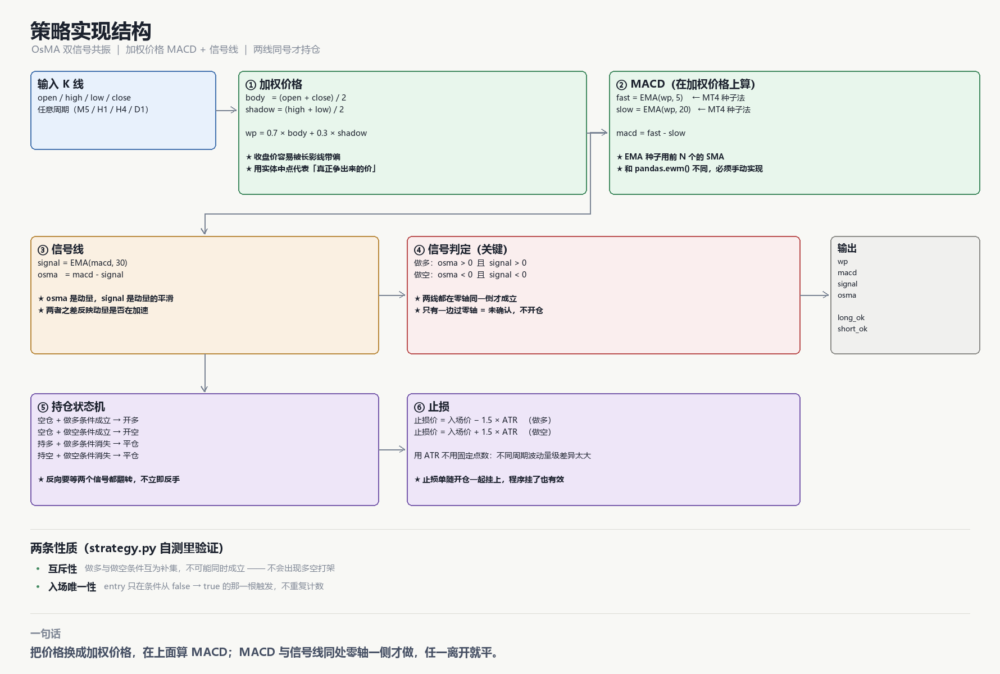
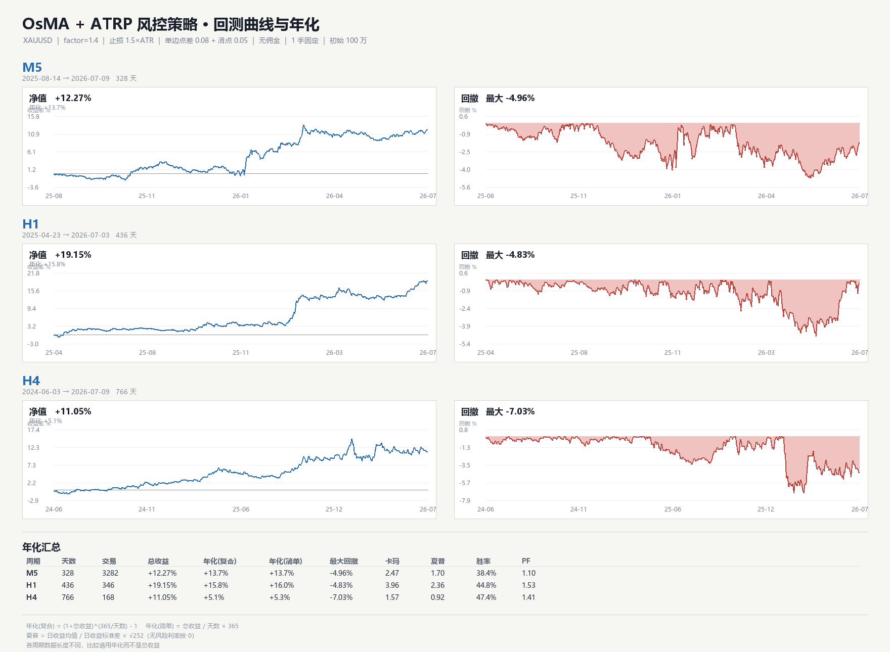
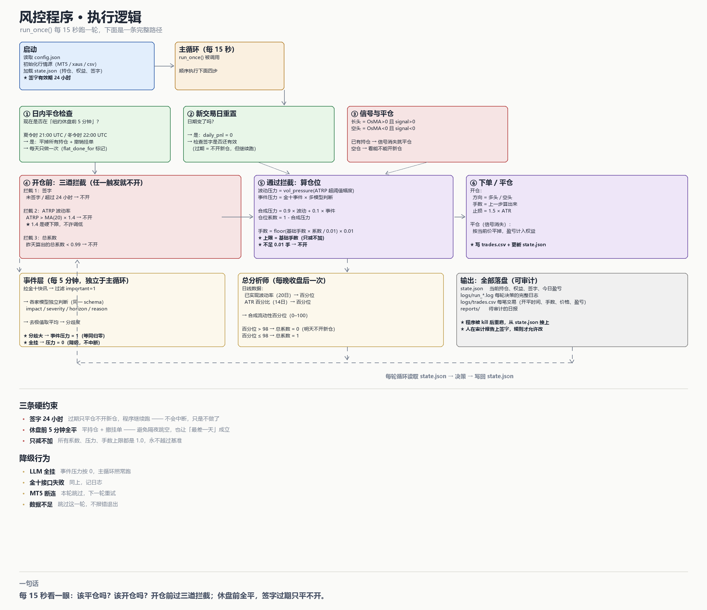

# 风控模型与交易策略

一套完整的日内交易**风控系统**，包含指标实现、风控分层、实盘执行、审计流程，以及对策略本身的回测验证。

品种：XAUUSD（伦敦金）　平台：MetaTrader 5

**这不是一个"高收益策略"，这是一个"知道什么时候不该做"的系统。**

---

## 为什么做这个

策略的收益来自市场，但**亏钱往往来自执行和风控的失控**。

这个项目解决三个问题：

1. **什么时候不该开仓** —— 波动率异常、流动性枯竭、事件冲击
2. **已经开了的仓位怎么减** —— 双规则减半，各自独立
3. **出了事怎么复盘** —— 每日战报 + 签字审计

---

## 核心设计：风控只防"跨日不恢复"的风险

这条原则决定了所有规则：

| 风险类型 | 谁负责 |
|---|---|
| 盘中正常回撤 | 策略自己的止损 |
| 跳空、闪崩、流动性枯竭 | **风控** |
| 事件冲击（战争、央行） | **风控** |

**风控不该对盘中波动敏感** —— 否则它会变成第二个策略，和主策略打架。

---

## 组成部分

```
数据（MT5 / CSV） → 指标层 → 风控层 → 执行层 → 审计层
```



### 1. 策略层



代码：[`strategy/strategy.py`](strategy/strategy.py)

| 指标 | 说明 |
|---|---|
| **OsMA** | 加权价格（实体 0.7 + 影线 0.3）做 MACD，再取信号线 |
| **信号判定** | OsMA 与 Signal 同处零轴一侧才持仓，任一离开就平仓 |

**为什么用加权价格**：收盘价容易被一根长影线带偏。用实体中点代表「多空真正争出来的价位」，影线只保留小权重，让极端插针有影响但不主导。

指标从 MQL4 移植，[`strategy/strategy.py`](strategy/strategy.py) 里的 EMA 种子算法和 MT4 一致（用前 N 个的 SMA 做种子，而非 pandas 的 ewm）。

### 2. 风控层（三层）

**① 开仓前：拦截**

```
ATRP > MA(20) × 1.4         → 不开新仓
昨日流动性百分位 ≥ 98%       → 不开新仓
签字过期（24h）              → 不开新仓
```

**② 持仓中：减仓（两个规则各占 50%）**

```
ATRP 越线                → 平掉当前持仓的一半
事件严重度 ≥ 0.7（LLM）  → 平掉当前持仓的一半
两条同时触发             → 归零
```

每次平掉**当前持仓**的一半（连乘），不是原始仓位。各规则只触发一次。

**③ 时间：日内清空**

纽约休盘前 5 分钟平掉全部持仓、撤销挂单。避免隔夜跳空，也让"最差情况是一天"这句话成立。

### 3. 执行层

- MT5 真实下单（模拟账户验证过）
- 部分平仓（支持减半）
- 止损单自动挂上（1.5×ATR），程序挂了 MT5 那边还有保护
- 状态落盘，程序被 kill 后重启能接上

### 4. 审计层

- **每日战报**：今日交易明细、风控状态、事件判断、未来三天重要数据
- **签字机制**：战报未读完，签字按钮是灰的
- **签字有效期 24 小时**：过期只平仓不开新仓，程序不中断

---

## 回测结果

统一口径：单边点差 0.08 + 滑点 0.05，无佣金，止损 1.5×ATR，1 手固定仓位，初始 100 万。

**同一区间（2025-08 → 2026-07，322 天）三个周期对比：**

| 周期 | K线数 | 交易 | 收益 | 年化 | 最大回撤 | 卡玛 | 夏普 | 胜率 | PF |
|---|---|---|---|---|---|---|---|---|---|
| M5 | 62558 | 3229 | 11.86% | 13.6% | -4.96% | 2.39 | 1.67 | 38.4% | 1.10 |
| **H1** | 5191 | 253 | **16.85%** | **19.5%** | **-4.83%** | **3.49** | **2.56** | 45.4% | **1.57** |
| H4 | 1336 | 60 | 7.78% | 9.1% | -7.03% | 1.11 | 1.10 | 49.3% | 1.47 |



**结论：H1 最佳。** 不只是数字最好，还因为它的持仓周期（10 小时）对实盘延迟、漏单、滑点扩大都不敏感。M5 交易 3229 笔，实盘执行成本会显著侵蚀收益。

**注意：这只是 322 天的回测，样本量还不足以下结论。**

---

## 风控参数敏感性

ATRP factor 从 1.4 到 2.5 的扫描结果：

| 周期 | 1.4 | 1.6 | 2.0 | 2.2 | 最优 |
|---|---|---|---|---|---|
| M5 | 卡玛 1.02 | 1.13 | 1.18 | 1.19 | 2.2 |
| H1 | **1.21** | 1.20 | 1.15 | 1.17 | 1.4 |
| H4 | 0.83 | 0.96 | 0.68 | 0.77 | 1.6 |

**三个周期的最优值各不相同，说明这个参数本身不稳健。** 取 1.4 作为保守值（也是硬下限，低于 1.4 会严重耽误策略运行）。

---

## 目录结构

```
risk-control-trading/
├── trader/              主程序
│   ├── main.py          主循环
│   ├── broker.py        纸面 / MT5 下单（含部分平仓）
│   ├── mt5_broker.py    MT5 接口封装
│   ├── market_data.py   数据源适配（csv / xaus / mt5）
│   ├── order_risk.py    持仓风控：双规则减半
│   ├── daily_analyst.py 总分析师：日线百分位 → 仓位系数
│   ├── daily_report.py  每日战报生成
│   ├── ui.py            图形界面
│   └── approve.py       签字工具
├── mql5/                MT5 指标（可视化）
│   ├── OsMA_Signal.mq5  副图：OsMA + 信号线 + 多空区间
│   ├── ATRP_Risk.mq5    副图：ATRP + 阈值线 + 预警
│   └── OsMA_Risk.mq5    主图：信号箭头
├── strategy/            策略实现（信号逻辑）
├── osma/                指标移植（MQL4 → Python）
├── risk/                风控回测
├── event/               事件层（金十 + LLM）
├── bt_final_report.py   回测 + 年化 + 出图
├── bt_same_period.py    同区间对比
└── bt_audit.py          成本敏感性审查
```

---

## 快速开始

### 环境

- Windows
- Python 3.10+
- MetaTrader 5 客户端（需要一直开着）

### 安装

```bash
pip install pandas numpy Pillow MetaTrader5
```

### 配置

```bash
copy config.example.json config.json
```

然后填入你的 MT5 账号、服务器，以及 LLM API key（可选）。

### 运行

```bash
# 自检（不启动主循环）
python trader/selftest.py

# 图形界面
双击 trader/run.bat

# 命令行
python trader/main.py
```

---

## 程序执行逻辑

每一轮主循环做什么、什么情况下开仓/平仓/被拦截：



---

## 三条硬约束

写在这里，是因为它们在代码里有强制检查：

1. **签字 24 小时** —— 过期只平仓不开新仓
2. **休盘前 5 分钟全平** —— 平持仓 + 撤挂单
3. **只减不加** —— 所有系数、压力、手数上限都是 1.0，永不越过基准

---

## License

MIT


