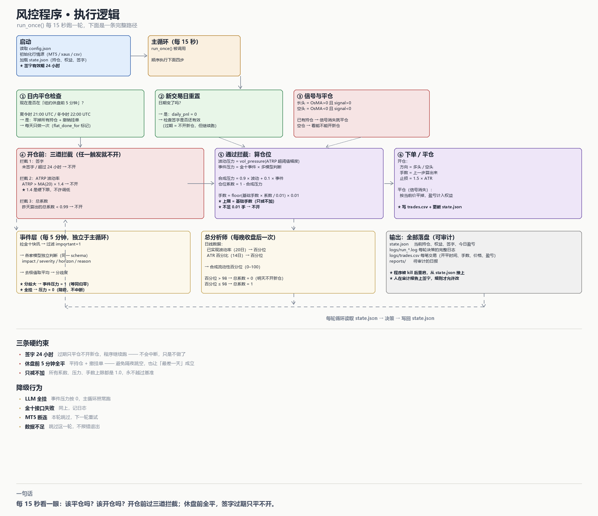

# 程序执行逻辑



`run_once()` 每 15 秒跑一轮。下面是一条完整路径。

---

## 启动

读取 `config.json` → 初始化行情源 → 加载 `state.json`（持仓、权益、签字）→ 检查签字有效期。

---

## 每轮循环

### ① 日内平仓检查

现在是否在「纽约休盘前 5 分钟」？

- 夏令时 EDT：21:00 UTC（北京 05:00）
- 冬令时 EST：22:00 UTC（北京 06:00）

是 → 平掉所有持仓 + 撤销挂单。每天只做一次。

### ② 新交易日重置

日期变了 → `daily_pnl = 0`，重新检查签字是否还有效。

### ③ 信号与平仓

- 多头 = `OsMA > 0` 且 `signal > 0`
- 空头 = `OsMA < 0` 且 `signal < 0`
- 已有持仓 → 信号消失就平仓
- 空仓 → 看能不能开新仓

### ④ 开仓前：三道拦截

任一触发就不开：

1. **签字** —— 未签字或超过 24 小时
2. **ATRP** —— `ATRP > MA(20) × 1.4`
3. **总系数** —— 昨日流动性百分位 ≥ 98%

### ⑤ 通过拦截：算仓位

```
波动压力 = vol_pressure(ATRP 超阈值幅度)
事件压力 = 金十事件 × 多模型判断

合成压力 = 0.9 × 波动 + 0.1 × 事件
仓位系数 = 1 - 合成压力

手数 = floor(基础手数 × 系数 / 0.01) × 0.01
```

上限 = 基础手数（只减不加）。不足 0.01 手就不开。

### ⑥ 下单

- 方向、手数、止损（1.5 × ATR）
- 写 `trades.csv` + 更新 `state.json`

---

## 持仓风控（独立于主流程）

有持仓时，每轮都检查两条规则：

```
ATRP 越线          → 平掉当前持仓的一半
事件严重度 ≥ 0.7    → 平掉当前持仓的一半
两条同时触发        → 归零
```

**每次平「当前持仓」的一半（连乘）**：1 手 → 0.5 → 0.25 → …

每条规则每次开仓只触发一次，避免同一原因重复砍。

---

## 事件层（每 5 分钟，独立于主循环）

1. 拉金十快讯 → 过滤 `important=1`
2. 各家模型独立判断（同一 schema：`impact` / `severity` / `horizon` / `reason`）
3. 去极值取平均 → 分歧检查
4. 平均 `severity ≥ 0.7` → 触发

**分歧大 → 事件压力 = 1（等同归零）。全挂 → 压力 = 0（降级，不中断）。**

---

## 总分析师（每晚一次）

```
日线已实现波动率(20)  → 百分位
日线 ATR%(14)        → 百分位
                     → 合成 0-100 百分位

< 90%           → 系数 1.0
90% ≤ x < 98%   → 系数 0.5
≥ 98%           → 系数 0.0（暂停开仓）
```

**中段完全不压，只抓极端。**

---

## 输出：全部落盘

| 文件 | 内容 |
|---|---|
| `state.json` | 当前持仓、权益、签字、今日盈亏 |
| `logs/run_*.log` | 每轮决策的完整日志 |
| `logs/trades.csv` | 每笔交易（开平时间、手数、价格、盈亏） |
| `reports/战报_*.txt` | 每日战报 |

程序被 kill 后重启，从 `state.json` 接上。

---

## 降级行为

| 情况 | 处理 |
|---|---|
| LLM 全挂 | 事件压力按 0，主循环照常 |
| 金十接口失败 | 同上，记日志（连续失败会进入退避模式） |
| MT5 断连 | 本轮跳过，下一轮重试 |
| 签字过期 | 不开新仓，继续跑 |
| 数据不足 | 跳过这一轮，不报错退出 |
