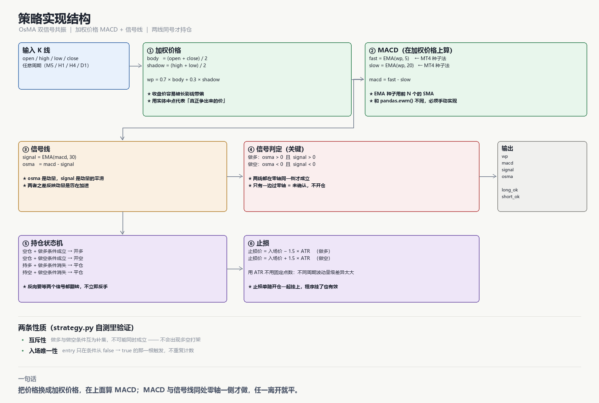

# 策略实现细节

代码：[`strategy/strategy.py`](../strategy/strategy.py)



---

## 信号逻辑

```
OsMA   = MACD(加权价格) - EMA(OsMA, SignalEMA)
Signal = EMA(OsMA, SignalEMA)

做多：OsMA > 0  且  Signal > 0      （两线都在零轴上方）
做空：OsMA < 0  且  Signal < 0      （两线都在零轴下方）
平仓：任一信号消失
反向：等两个信号同时翻转才反手
```

两个条件互为补集，所以「两值同号才持仓」和「任一消失就平仓」是同一件事的两种说法。

**已在代码自测里验证互斥性：** 做多与做空条件不可能同时成立。

---

## 为什么这样设计

只看 OsMA 一件不够：OsMA 穿过零轴时，价格经常已经在回抽。

加上 Signal 的约束，等于要求「动量和动量的加速度同向」—— 入场变少，但每次入场的确定性更高。

---

## 加权价格

普通 K 线用收盘价代表"这一刻的价格"，但收盘价容易被一根长影线带偏。

```
加权价格 = (0.7 × 实体中点 + 0.3 × 影线中点)
实体中点 = (open + close) / 2
影线中点 = (high + low) / 2
```

实体权重大，代表「多空真正争夺出来的价位」；影线权重小，只是为了让极端插针有一点影响，但不主导。

---

## 止损

```
止损价 = 入场价 - 1.5 × ATR   （做多）
止损价 = 入场价 + 1.5 × ATR   （做空）
```

用 ATR 而不是固定点数：不同周期的波动量级差异很大，ATR 让止损跟着市场自己调整。

止损单随开仓一起挂到 MT5，程序挂了那边还有保护。

---

## EMA 种子算法

MT4 的 `iMA(MODE_EMA)` 用前 period 个值的 SMA 作为种子，然后递推。

**这和 pandas 的 `ewm()` 不一致**（后者从第一个值开始）。移植时必须手动实现，否则前几百根 K 线的指标会有偏差。

```python
alpha = 2.0 / (period + 1.0)
out[period - 1] = mean(first period values)
for i in period..n:
    out[i] = value[i] * alpha + out[i-1] * (1 - alpha)
```

---

## 参数

| 参数 | 默认值 | 说明 |
|---|---|---|
| fast | 5 | MACD 快线 |
| slow | 20 | MACD 慢线 |
| signal | 30 | 信号线 EMA 周期 |
| weight_body | 0.7 | 加权价格里实体占比 |
| weight_shadow | 0.3 | 加权价格里影线占比 |
| atr_mult | 1.5 | 止损的 ATR 倍数 |

这些数字都是占位值，没有从回测里估出来。
